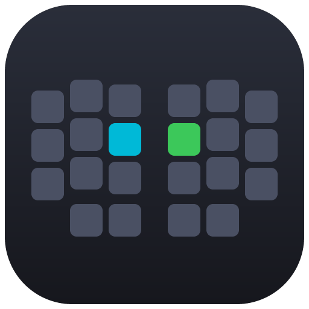
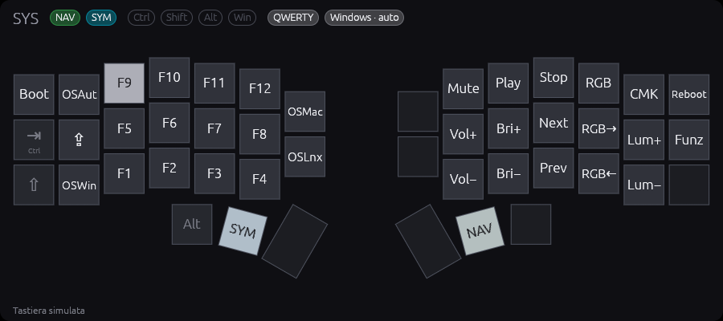
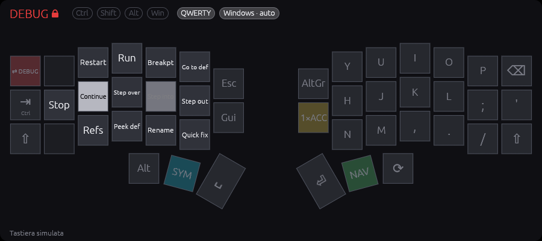
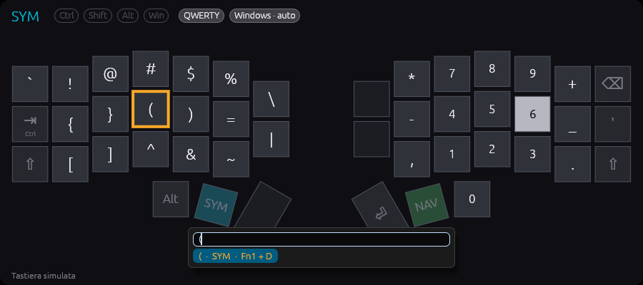
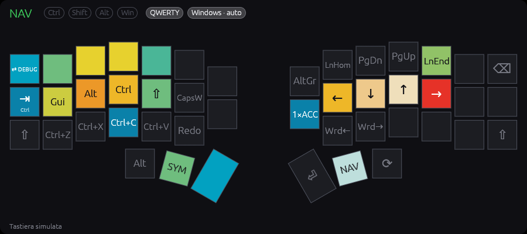
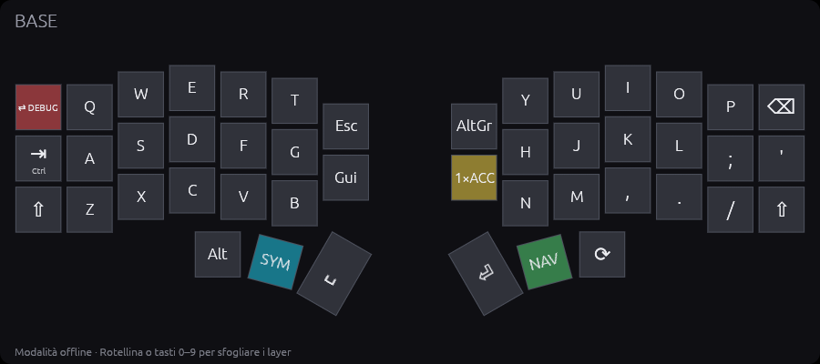

#  Keyboard HUD

Un HUD sempre in primo piano che mostra la mia **Corne v4.1** (firmware Vial) e la aggiorna in tempo reale: layer attivo con le sue legende, tasti premuti, modificatori, one-shot, Caps Lock / Caps Word, QWERTY o Colemak-DH, sistema operativo.



- **Portable**: un solo eseguibile per sistema, niente installazione e niente permessi di amministratore. Funziona anche da una chiavetta USB.
- **La fonte di verità è la tastiera**: l'HUD interroga il firmware via Raw HID, la stessa interfaccia di Vial. Niente hook di sistema, niente keylogger, nessun permesso di Accessibilità. Funziona anche su Wayland.
- **Nessun testo registrato**: l'HUD riceve solo quali tasti fisici sono premuti e su quale layer, mai i caratteri.

| | |
|---|---|
|  |  |
| Layer DEBUG bloccato, con le etichette di VS Code | Ricerca: `(` si trova su SYM, con **Fn1 + D** |
|  |  |
| Heatmap delle pressioni | Modalità offline (vial.json + .vil) |

---

## Indice

1. [Download](#download)
2. [Primo avvio](#primo-avvio)
3. [Firmware](#firmware)
4. [Uso](#uso)
5. [Linux: regola udev](#linux-regola-udev)
6. [Windows: SmartScreen](#windows-smartscreen)
7. [Wayland](#wayland)
8. [Convivenza con Vial](#convivenza-con-vial)
9. [Configurazione](#configurazione)
10. [Stili](#stili)
11. [Backup automatico](#backup-automatico)
12. [Statistiche e privacy](#statistiche-e-privacy)
13. [Modalità offline e simulata](#modalità-offline-e-simulata)
14. [Opzioni da riga di comando](#opzioni-da-riga-di-comando)
15. [Compilare l'app](#compilare-lapp)
16. [Risoluzione dei problemi](#risoluzione-dei-problemi)
17. [Licenza e crediti](#licenza-e-crediti)

---

## Download

Dalla pagina **Releases** del repository:

| Sistema | File |
|---|---|
| Windows 10/11 (x86_64) | `keyboard-hud-windows-x86_64.exe` |
| macOS 11+ (Apple Silicon e Intel) | `keyboard-hud-macos-universal.zip` (contiene `Keyboard HUD.app`) |
| Linux x86_64 (glibc, Ubuntu 22.04+, Fedora recente) | `keyboard-hud-linux-x86_64` |

Ogni release contiene anche `SHA256SUMS.txt` e `keyboard-hud.example.toml`.

## Primo avvio

1. Flasha il firmware con il supporto HUD su **entrambe** le metà (vedi [Firmware](#firmware)).
2. Metti l'eseguibile in una cartella qualsiasi e avvialo:
   - **Windows**: doppio clic. Se SmartScreen avvisa (l'eseguibile non è firmato), scegli *Ulteriori informazioni → Esegui comunque*, oppure sblocca il file una volta per tutte (vedi [Windows: SmartScreen](#windows-smartscreen)).
   - **macOS**: estrai lo zip. La prima volta fai clic destro su `Keyboard HUD.app` → *Apri* (l'app è firmata ad-hoc, non da uno sviluppatore Apple registrato). In alternativa: `xattr -dr com.apple.quarantine "Keyboard HUD.app"`. L'app non compare nel Dock: si chiude dal menu contestuale dell'HUD.
   - **Linux**: `chmod +x keyboard-hud-linux-x86_64 && ./keyboard-hud-linux-x86_64`. Serve una regola udev, una sola volta (vedi [Linux](#linux-regola-udev)).
3. L'HUD compare in sovrimpressione. Con l'**heads-up** attivo (default) si nasconde da solo e ricompare quando tieni Fn1/Fn2, quando un one-shot è in attesa o quando tieni un modificatore.

**Dove finiscono i file.** Se la cartella dell'eseguibile è scrivibile, o contiene già `keyboard-hud.toml` (modalità portable), tutto sta lì accanto. Altrimenti si usa la cartella di configurazione dell'utente (`%APPDATA%\keyboard-hud\config`, `~/Library/Application Support/keyboard-hud`, `~/.config/keyboard-hud`). I file sono:

| File | Contenuto |
|---|---|
| `keyboard-hud.toml` | la tua configurazione (facoltativa) |
| `keyboard-hud-state.toml` | posizione della finestra nell'ultima sessione |
| `keyboard-hud-stats.json` | contatori delle statistiche |
| `backups/` | backup automatici della configurazione della tastiera (`.vil`) |
| `keyboard-hud.log` (+ `.log.1`) | log, massimo 1 MB per file |
| `cache/` | definizione Vial letta dalla tastiera |

## Firmware

Il firmware è la keymap Vial in `firmware/mia/`, per `crkbd/rev4_1/standard` nel fork [vial-qmk](https://github.com/vial-kb/vial-qmk). Il supporto HUD è la sezione **9. HUD (Raw HID)** di `keymap.c`; il protocollo è descritto in [docs/PROTOCOL.md](docs/PROTOCOL.md).

```sh
# una tantum: collega la keymap all'albero di vial-qmk
ln -s "$PWD/firmware/mia" ~/git/vial-qmk/keyboards/crkbd/keymaps/mia

cd ~/git/vial-qmk
qmk compile -kb crkbd/rev4_1/standard -km mia -e SKIP_VERSION=yes
```

Il file da flashare è `crkbd_rev4_1_standard_mia.uf2`. **Flasha entrambe le metà**: per ognuna tieni premuto il pulsante di reset (o usa `QK_BOOT` sul layer SYS), poi copia il file `.uf2` sull'unità che compare.

Dopo il flash, da Vial assegna **`HUD_TOG`** (tab *User*, ultimo tasto) dove preferisci, ad esempio su un tasto libero del layer SYS.

Il firmware funziona identico anche senza HUD collegato. Risponde solo alle richieste dell'HUD, non invia mai dati di sua iniziativa e non scrive nulla in EEPROM.

## Uso

**Il menu** (clic destro sull'HUD) ha in alto le azioni sul tasto cliccato (*Cambia questo tasto…*, *Annulla l'ultima modifica*) e gli interruttori più usati (heads-up, click-through, pausa); sotto, gruppi che si aprono con un clic: **Finestra** (opacità, scala, vista, posizione), **Stile e colori** (tema, stili, tasti), **Sui tasti** (combo, keycast, heatmap), **Strumenti** (cerca, allenamento, statistiche, esportazione, backup, diagnostica), **Generale** (lingua, avvio con il sistema). In fondo *Impostazioni…* ed *Esci*.

| Azione | Come |
|---|---|
| Spostare l'HUD | trascinalo con il mouse. Su Windows si aggancia ai bordi, agli angoli e al centro dello schermo |
| Metterlo in un angolo, a metà di un bordo o al centro | menu → Finestra → Posizione (griglia 3×3) |
| Ingrandire / rimpicciolire (50–200%) | Ctrl + rotellina sull'HUD, oppure menu → Finestra → Scala |
| Menu (opacità, scala, vista, posizione, tema, heads-up, combo, heatmap, statistiche, ricerca, impostazioni, click-through, pausa, avvio con il sistema, esci) | clic destro sull'HUD |
| Mostrare / nascondere | un tocco di **HUD_TOG**. Con l'heads-up attivo il tocco *fissa* l'HUD a schermo, e un altro tocco lo restituisce all'heads-up |
| Click-through (i clic passano alle finestre sotto) | menu, oppure **doppio tocco** di HUD_TOG. Si disattiva solo con il doppio tocco |
| Cercare un tasto | Ctrl+F o `/` con l'HUD in primo piano, oppure menu → Strumenti → Cerca. Frecce per scegliere, Invio/Esc per chiudere. Trova anche combo, tap dance e key override |
| Vedere le combo | menu → Sui tasti → Mostra le combo |
| Avviare l'HUD all'accesso | menu → Generale → Avvia con il sistema (vedi sotto) |
| Icona nella tray | clic sinistro: mostra/nasconde l'HUD; clic destro: menu con pausa, backup, statistiche, impostazioni, avvio con il sistema, esci |
| Impostazioni | Ctrl+, con l'HUD in primo piano, menu → Impostazioni…, oppure la tray; Ctrl+Shift+, apre il file di testo |
| Sfogliare i layer (solo offline) | rotellina o tasti 0–9 |

Il menu si apre in una piccola finestra separata accanto al punto del clic, così resta leggibile anche con l'HUD rimpicciolito o in vista compatta. Si chiude con ✕, con Esc, con un clic sull'HUD o con un clic altrove. Su Wayland è il compositor a decidere dove compare.

**Icona nella tray.** Comoda soprattutto con l'HUD nascosto e su macOS, dove l'app non ha icona nel Dock. Su Linux passa da D-Bus (StatusNotifierItem), senza GTK: KDE, Xfce e la maggior parte dei pannelli la mostrano, GNOME solo con l'estensione *AppIndicator*. Si toglie con `tray = false` in `[appearance]`.

**Avvio con il sistema.** Vale solo per il tuo utente e non chiede permessi di amministratore: su Windows è un valore in `HKEY_CURRENT_USER\Software\Microsoft\Windows\CurrentVersion\Run`, su Linux il file `~/.config/autostart/keyboard-hud.desktop`, su macOS `~/Library/LaunchAgents/io.github.keyboard-hud.plist`. Registra il percorso dell'eseguibile e le opzioni `--x11`, `--vid`, `--pid` e `--verbose` con cui l'hai avviato. Se sposti l'eseguibile, la casella risulta vuota e il tooltip lo segnala: spuntala di nuovo per aggiornare il percorso. Con la modalità portable su una chiavetta, l'avvio funziona solo se la chiavetta è collegata.

Il click-through si attiva solo se la tastiera collegata ha il tasto HUD_TOG, così c'è sempre un modo per disattivarlo. Se la tastiera si scollega, si spegne da solo.

**Cosa mostra l'HUD**

- **Layer**: nome e colore (gli stessi dei LED: SYM azzurro, NAV verde, DEBUG rosso, ACC giallo). Il lucchetto indica un layer bloccato (`TG`); `1×` con pulsazione indica un one-shot in attesa. Gli altri layer attivi compaiono come etichette.
- **Legende**: quelle del layer attivo, già con Colemak-DH applicato dal firmware. I tasti trasparenti mostrano attenuata la legenda del layer sotto; i tasti layer hanno il colore del layer di destinazione; i mod-tap mostrano il tocco in grande e il modificatore in piccolo. Il tooltip dà il nome completo.
- **Modificatori**: Ctrl, Shift, Alt, Gui (Cmd/Opt su macOS). Pieno = tenuto, pallido = weak, contorno pulsante = one-shot, lucchetto = one-shot bloccato.
- **Caps Lock / Caps Word, QWERTY / Colemak-DH, OS** rilevato o forzato; **Bloc Num** nella vista completa.
- **Altra metà scollegata**: se la metà senza USB smette di rispondere (cavo TRRS staccato), un avviso rosso nell'HUD e nel mini indicatore. Compare solo dopo che l'altra metà è stata vista collegata, così una tastiera non split non dà falsi allarmi.
- **Macro**: il tasto mostra cosa scrive o preme (`hi⏎`, `Ctrl+C`, troncato a 6 caratteri) con `M0` in piccolo; il tooltip elenca ogni passo. Le macro si leggono dalla tastiera a ogni connessione, o dal `.vil` in offline.
- **Tasti premuti**: si accendono subito e sfumano in 200 ms.
- **Lingua**: italiano o inglese (*English*), dal menu o con `language` in `[appearance]`; con `auto` segue il sistema. Cambiano interfaccia, tooltip, ricerca, CSV delle statistiche e nuove voci del `CHANGELOG.md` dei backup; il log resta in italiano.
- **Keycast** (menu → Sui tasti → *Keycast*, o `[keycast] enabled = true`): per video e presentazioni, in basso sullo schermo compaiono per due secondi e mezzo le scorciatoie premute: `Ctrl+Shift+P`, `Alt+Tab`, `F5`, `Esc`, frecce, tasti multimediali. **Mai il testo**: un tasto che scrive un carattere compare solo insieme a Ctrl, Alt o Gui (Shift da solo non basta), e Invio, Spazio e Backspace non compaiono mai da soli. Niente viene salvato. I mod-tap (Ctrl sulla home row) funzionano: il tasto aspetta un attimo che il modificatore arrivi.
- **Cambiare un tasto senza Vial**: clic destro **sopra il tasto** da cambiare → *Cambia questo tasto…* (prima voce del menu; aperto altrove, il menu la mostra disattivata). Si cerca il nuovo tasto per nome o descrizione (`esc`, `redo`, `MO(2)`, `HUD_TOG`) oppure lo si scrive come in Vial (`C(KC_Z)`, `LCTL_T(KC_A)`, `LT1(KC_SPC)`). Prima di scrivere, l'HUD avvisa se un layer non si potrà più raggiungere o se sparisce l'ultimo `QK_BOOT` o `HUD_TOG`, e chiede conferma. `QK_BOOT` si assegna solo da Vial. Subito prima di ogni scrittura viene fatto un [backup](#backup-automatico) e la modifica finisce nel `CHANGELOG.md`; menu → *Annulla l'ultima modifica* rimette il tasto di prima. Con Colemak attivo le lettere dei layer rimappati vanno cambiate in QWERTY. Macro, tap dance, combo, key override e impostazioni restano in Vial.
- **Esportare la keymap** (menu → Strumenti → *Esporta la keymap…*, oppure `--export FILE`): una pagina HTML con un disegno per ogni layer, nei colori dei layer e con le tue etichette, più l'elenco di combo, tap dance, macro e key override. Si apre nel browser, da cui si stampa o si salva in PDF. I file finiscono in `export/` accanto alla configurazione.
- **Allenamento** (menu → Strumenti → *Allenamento…*): l'HUD chiede un simbolo o una scorciatoia (`{`, `Ctrl+Z`, `F5`) e aspetta che tu la prema, 20 domande per giro. Dopo 6 secondi mostra come si fa (`Fn1 + D`) e illumina il tasto sull'HUD. Escono più spesso i tasti dei layer superiori che usi poco (dalle [statistiche](#statistiche-e-privacy), se attive) e quelli sbagliati; alla fine ci sono i risultati e i tasti da ripassare. Vale anche Shift + tasto per un simbolo con Shift. Serve il firmware HUD.
- **Diagnostica** (menu → Strumenti → *Diagnostica…*): tastiera, protocollo del firmware, letture al secondo, latenza delle risposte, errori e riconnessioni, OS rilevato, altra metà, percorsi dei file, ultimo backup. *Copia tutto* la mette negli appunti, pronta per una segnalazione.
- **Mini indicatore**: quando l'HUD è nascosto (heads-up o HUD_TOG), un piccolo badge in un angolo dello schermo ricorda gli stati che restano dopo aver rilasciato i tasti: layer bloccato (per esempio DEBUG con il lucchetto), one-shot in attesa, modificatori bloccati, Caps Lock, Caps Word. Mostra anche perché manca la tastiera (non trovata, in pausa per Vial) e, per due secondi, cosa è appena cambiato: QWERTY/Colemak-DH, OS rilevato o forzato, HUD nascosto da HUD_TOG. Non intercetta i clic. Con `locked_layer = "indicator"` un layer bloccato non tiene più su l'HUD intero, ma solo il badge; con `oneshot = "indicator"` vale lo stesso per i one-shot in attesa (layer e modificatori), con `modifiers = "indicator"` per i modificatori tenuti a lungo.
- **Tap dance, combo e key override** configurati in Vial, letti dalla tastiera a ogni connessione (quindi anche quando l'HUD riprende dopo la pausa per Vial) oppure dal `.vil` in modalità offline:
  - un tasto tap dance mostra in grande l'azione al tocco e in piccolo quella tenendolo premuto (o il doppio tocco); il tooltip le elenca tutte;
  - con *Mostra le combo* ogni combo è un'etichetta con il risultato fra i tasti da premere insieme;
  - un key override si vede mentre lo usi: tenendo Shift, il tasto ⌫ mostra ⌦ in colore (con l'override Shift+⌫ = Canc).
- **Ricerca**: oltre ai tasti trova le combo (`combo: J + K insieme`), le azioni dei tap dance (`Q (tieni)`) e i key override (`Shift + Bksp`).

## Linux: regola udev

Su Linux l'accesso a `/dev/hidraw*` richiede una regola udev. È l'unico passaggio con `sudo`, da fare una volta. Se manca, l'HUD lo dice nel suo stato.

```sh
./keyboard-hud-linux-x86_64 --print-udev-rule
```

Stampa questa regola, la stessa consigliata da Vial (se Vial ti funziona già, è probabilmente già installata):

```
KERNEL=="hidraw*", SUBSYSTEM=="hidraw", ATTRS{serial}=="*vial:f64c2b3c*", MODE="0660", GROUP="users", TAG+="uaccess", TAG+="udev-acl"
```

```sh
sudo nano /etc/udev/rules.d/59-vial.rules        # incolla la riga
sudo udevadm control --reload && sudo udevadm trigger
```

Poi scollega e ricollega la tastiera.

## Windows: SmartScreen

L'eseguibile non è firmato con un certificato di sviluppatore, quindi la prima volta Microsoft Defender SmartScreen mostra *"Windows ha protetto il PC"*. L'avviso dipende dal segno "scaricato da Internet" che il browser mette sul file, non da un problema dell'app. Per toglierlo una volta per tutte:

- clic destro sull'`.exe` → *Proprietà* → spunta **Sblocca** → *OK*;
- oppure, da PowerShell: `Unblock-File .\keyboard-hud-windows-x86_64.exe`.

Prima di sbloccarlo puoi confrontarlo con `SHA256SUMS.txt` della release: `Get-FileHash .\keyboard-hud-windows-x86_64.exe`. Se è l'antivirus di Defender a segnalarlo (falso positivo), il file si può inviare a Microsoft per l'analisi dal portale *Microsoft Security Intelligence*. Un eseguibile compilato da te dai sorgenti non ha il segno e non fa scattare l'avviso.

## Wayland

Su Wayland è il compositor a decidere la posizione delle finestre e se possono restare sempre in primo piano: molti (GNOME in particolare) ignorano entrambe le richieste. Se l'HUD finisce sotto le altre finestre o non ricorda la posizione, avvialo con:

```sh
./keyboard-hud-linux-x86_64 --x11
```

L'opzione forza XWayland, dove "sempre in primo piano" e la posizione funzionano. Anche il click-through dipende dal compositor.

## Convivenza con Vial

Vial e l'HUD usano la stessa interfaccia Raw HID. Le risposte destinate all'uno potrebbero finire nell'altro e confonderlo. Per questo:

- se l'HUD trova il processo **Vial** (o VIA) in esecuzione, chiude il dispositivo e mostra *"In pausa: Vial è aperto"*. Il controllo avviene ogni 2 secondi;
- quando Vial si chiude, l'HUD si ricollega da solo e **rilegge il keymap**, che potresti aver appena cambiato;
- la **web app di Vial** (o di VIA) gira nel browser e non si vede tra i processi. In compenso l'HUD si accorge delle risposte che non ha chiesto: smette di interrogare la tastiera, mostra *"In pausa: un altro programma usa la tastiera"* e riprende dopo 20 secondi di silenzio, rileggendo tutto;
- dal menu c'è anche una **pausa manuale**.

Con la web app la protezione automatica scatta solo dopo il primo scambio tra browser e tastiera, e riparte se la web app resta ferma più di 20 secondi. **Per lavorare tranquillo con la web app metti l'HUD in pausa dal menu** e togli la pausa quando hai finito.

L'HUD si accorge comunque dei cambi di keymap fatti da Vial. Il firmware rileva le modifiche in pochi millisecondi e l'HUD rilegge le legende. Fa lo stesso dopo `CMK_TOG` (QWERTY/Colemak-DH).

## Configurazione

Copia [`keyboard-hud.example.toml`](keyboard-hud.example.toml) accanto all'eseguibile con il nome `keyboard-hud.toml`, oppure nella cartella di configurazione dell'utente. Ogni voce è facoltativa. Le modifiche valgono **entro un secondo, senza riavviare**; solo `[device]` richiede un riavvio.

**Finestra Impostazioni** (menu → *Impostazioni…*, icona nella tray, oppure **Ctrl+,** con l'HUD in primo piano), come in VS Code: tutte le voci del file divise per sezione, con la descrizione, una casella di ricerca, un pallino sulle voci diverse dal predefinito e ↺ per ripristinarlo. Ogni modifica si salva subito in `keyboard-hud.toml` toccando solo quella voce: commenti e ordine del file restano. *Apri come testo* (o **Ctrl+Shift+,**) apre il file nell'editor di sistema; se il file contiene un errore la finestra lo mostra e resta in sola lettura finché non lo correggi.

- **Layer**: nome e colore di ogni layer, nell'ordine del firmware, con il selettore di colore (o *neutro*); *Aggiungi layer* e ✕ sull'ultimo.
- **Etichette**: una scheda per etichetta con testo, descrizione, tasto (keycode oppure riga e colonna della matrice), layer e app. Un keycode non riconosciuto o un'etichetta incompleta vengono segnalati sulla scheda. La ricerca in alto trova anche le etichette.
- **File di testo**: il file intero con i commenti, modificabile nella finestra; *Salva* (Ctrl+S) scrive solo un file valido, altrimenti mostra l'errore con la riga. Serve anche a correggere un file rotto senza uscire dall'app.

Slider, numeri e colori si salvano quando rilasci il mouse; i campi di testo quando premi Invio o passi ad altro.

| Sezione | Cosa regola |
|---|---|
| `[device]` | `vid` / `pid` per scegliere la tastiera (default: la prima che risponde al protocollo HUD) |
| `[appearance]` | icona nella tray (`tray`), opacità (default 85%), scala, tema (`system`/`dark`/`light`), vista (`full`/`compact`), posizione iniziale, distanza di aggancio ai bordi (`snap_distance`, 16) e margine dai bordi (`screen_margin`, 8), stile (`style`), opacità e arrotondamento dei tasti (`key_opacity`, `key_radius`), combo sopra i tasti (`combos`), lingua (`language`: `auto`, `it`, `en`) |
| `[headsup]` | attivo, ritardo dei modificatori (400 ms), ritardo di scomparsa (800 ms), opacità da nascosto, cosa mostra un layer bloccato (`locked_layer`: `hud` o `indicator`) un one-shot in attesa (`oneshot`) e un modificatore tenuto (`modifiers`), sempre `hud` o `indicator` |
| `[keycast]` | keycast attivo (default no), posizione sullo schermo (`position`, default `bottom`) |
| `[indicator]` | mini indicatore attivo, angolo dello schermo (`position`, default `top-right`) |
| `[[layers]]` | nome e colore di ogni layer, in ordine |
| `[[labels]]` | etichette personalizzate, per keycode (anche limitato a un layer) o per posizione, anche solo per un'applicazione |
| `[stats]` | statistiche attive, file, periodo del report "mai usati" |
| `[backup]` | backup automatico attivo, cartella, quanti tenerne (default 30) |
| `[polling]` | frequenze di lettura (60 Hz visibile, 10 Hz nascosto) e timeout |
| `[log]` | livello del log |

Esempio di etichette (il file d'esempio contiene già tutto il layer DEBUG):

```toml
[[labels]]
layer = 4
keycode = "KC_F10"
label = "Step over"
description = "Esegui la riga (F10)"

[[labels]]
layer = 4
keycode = "C(KC_DOT)"      # anche S(...), A(...), C(S(...)), QK_KB_15 / USER15
label = "Quick fix"

[[labels]]                 # per posizione: layer, riga e colonna della matrice
layer = 0
row = 0
col = 0
label = "Debug"
```

**Etichette per applicazione.** Con `app` un'etichetta vale solo mentre quel programma è in primo piano, e a parità di tasto vince su quella generica. Così F10 può dire "Step over" in VS Code e restare F10 altrove:

```toml
[[labels]]
app = "code"               # anche una lista: ["idea64", "pycharm64"]
layer = 4
keycode = "KC_F10"
label = "Step over"
```

Il nome è quello del processo, senza `.exe` e senza distinguere maiuscole: `code` vale per `Code.exe` su Windows e per `code` su Linux; su macOS è il nome dell'app. Il footer dell'HUD mostra quale insieme di etichette è attivo. Su Wayland l'applicazione in primo piano non si può sapere: valgono solo le etichette generiche.

Le scelte fatte dal menu (scala, opacità, vista, tema, lingua, stile, opacità e arrotondamento dei tasti, heads-up, combo, keycast) e con Ctrl + rotellina vengono scritte in `keyboard-hud.toml`, creato se manca, toccando solo quelle voci: i commenti restano. `keyboard-hud-state.toml` ricorda solo la posizione della finestra; le scelte che le versioni precedenti tenevano lì passano nella configurazione al primo avvio.

## Stili

Uno stile decide colori e forma dell'HUD: arrotondamento e opacità dei tasti, bordi, dimensione delle legende, angoli e opacità della finestra. Non sceglie fra chiaro e scuro: ha colori per entrambi e segue il tema. Si sceglie dal menu (**Stile**) o con `style` in `[appearance]`.

Inclusi: **predefinito** (l'aspetto di sempre, tasti appena arrotondati), **minimal** (niente bordi, tasti morbidi), **vetro** (finestra e tasti semitrasparenti; un tasto premuto torna pieno), **alto-contrasto** (bianco e nero, bordi spessi, legende più grandi). Poi i colori dei temi più noti, in versione scura e chiara (segue *Tema*): **monokai**, **dracula**, **nord**, **solarized**, **gruvbox**, **catppuccin** (Mocha e Latte), **one** (One Dark e One Light), **tokyo-night**. I colori dei layer restano quelli di `[[layers]]`.

I tuoi stili sono file `.toml` nella cartella `styles/` accanto alla configurazione (menu → Stile e colori → **Cartella stili**); il nome del file è il nome dello stile, e un file con il nome di uno stile incluso lo sostituisce. Ogni voce è facoltativa:

```toml
# styles/notte.toml
key_opacity = 0.8       # 0.2 – 1: le legende restano piene
key_radius = 0.25       # 0 – 0.5 della dimensione del tasto
border_width = 0        # bordo dei tasti in pixel, 0 = nessuno
legend_scale = 1.1      # 0.7 – 1.5
window_radius = 16      # angoli della finestra
window_opacity = 0.7    # applicata quando scegli lo stile

[dark]                  # colori "#RRGGBB"; quelli mancanti restano i predefiniti
background = "#0B0E14"
key = "#1A1F2B"
accent = "#7AA2F7"

[light]
key = "#FFFFFF"
```

Colori disponibili: `background`, `key`, `key_empty`, `key_border`, `pressed`, `pressed_text`, `text`, `text_dim`, `neutral_layer`, `accent`, `chip_off`, `caps_word`, `colemak`, `warning`. I colori dei layer restano in `[[layers]]`, perché corrispondono ai LED del firmware.

**Salva come stile** (menu) scrive `styles/personale.toml` (o `personale-2.toml`, mai sopra un file esistente) con tutti i valori attuali, colori compresi: il modo più semplice per partire. Le modifiche al file dello stile in uso si vedono entro un secondo; se il file non è valido compare l'errore e resta lo stile di prima.

Opacità e arrotondamento dei tasti: il valore di `[appearance]` se c'è, altrimenti quello dello stile. Scegliere uno stile dal menu riparte dai suoi valori (toglie `key_opacity` e `key_radius` e applica l'opacità della finestra dello stile); cambiando `style` nel file o nelle Impostazioni le altre voci restano come sono.

## Backup automatico

L'HUD salva da solo la configurazione della tastiera come file `.vil`, lo stesso formato dell'export di Vial: keymap, encoder, macro, tap dance, combo, key override, alt-repeat e impostazioni QMK. Non serve ricordarsi di esportare dopo ogni modifica.

- **Quando**: alla connessione, quando chiudi Vial (o finisce il traffico della web app), quando il keymap cambia e, ogni 2 minuti a tastiera ferma, per combo e macro, che il firmware non segnala. Un nuovo file nasce **solo se qualcosa è cambiato** rispetto all'ultimo backup della stessa tastiera.
- **Dove**: cartella `backups/` accanto alla configurazione; si apre da menu → Strumenti → *Cartella dei backup…*. I file si chiamano `corne-v4_2026-10-22T081530Z.vil` (ora UTC); se ne tengono 30 per tastiera.
- **Confronto** (menu → Strumenti → *Storico dei backup…*): scegli due backup qualsiasi e vedi cosa è cambiato. I tasti cambiati sono evidenziati sulla tastiera disegnata, layer per layer; sotto c'è l'elenco a parole, con combo, tap dance, macro e impostazioni. *Rimetti com'era* accanto a un tasto apre *Cambia tasto* con il valore di prima, da controllare e scrivere. Un backup intero si ricarica in Vial (*File → Load saved layout*).
- **Storico**: nella stessa cartella, `CHANGELOG.md` racconta a parole cosa è cambiato a ogni backup, dal più recente. Per esempio:

  ```markdown
  ## 2026-10-22 06:53:40 UTC · Corne v4 · `corne-v4_2026-10-22T065340Z.vil`

  - NAV · tasto B (riga 2, colonna 5): Redo → Ctrl+Y
  - Combo aggiunta: J + K insieme → Esc
  - Key override disattivato: Shift + Bksp → Del (tutti i layer)
  - tapping term: 180 → 200
  ```

  Le stesse righe finiscono nel log, e l'HUD mostra un avviso con il numero di modifiche.
- **Ripristino**: in Vial, *File → Load saved layout*. I keycode sono scritti come numeri, una forma che Vial accetta: il file non è fatto per essere letto a mano.
- Le letture usano gli stessi comandi di Vial e non richiedono lo sblocco. Si disattiva con `enabled = false` nella sezione `[backup]`.

## Statistiche e privacy

- Si conta solo **quante volte** viene premuto ogni tasto fisico, su quale layer e in quale giorno (UTC).
- **Mai** testo, sequenze di tasti o tempi tra un tasto e l'altro. I dati restano sul tuo computer, in `keyboard-hud-stats.json`, e non vengono mai trasmessi.
- Si disattivano con `[stats] enabled = false` e si azzerano dalla finestra delle statistiche, con conferma.
- **Heatmap** (menu → Sui tasti → Heatmap): pressioni sul layer mostrato, oppure su tutti i layer insieme.
- **Finestra delle statistiche** (menu → Strumenti → Statistiche): utilizzo dei layer, distribuzione tra le mani, le dita e le righe (quanto lavori sulla home row), tasti più usati con la combinazione per raggiungerli, attività giornaliera, tasti mai usati negli ultimi N giorni, esportazione CSV (`keyboard-hud-stats.csv`).
- **Suggerimenti**: se un tasto molto usato di un layer superiore sta in una posizione faticosa (mignolo, righe alta e bassa, colonne di allungamento), la finestra propone di scambiarlo con una posizione comoda e poco usata dello stesso layer, con il risparmio stimato. Segnala anche se una mano lavora molto più dell'altra. Il layer base non viene toccato: la disposizione delle lettere è una scelta di layout. Il modello di fatica è semplice (dito, riga, allungamento) e va preso come uno spunto, non come una regola.
- Il conteggio si basa sugli stati letti dalla tastiera. Con l'HUD visibile la lettura è a 60 Hz, da nascosto almeno a 30 Hz se le statistiche sono attive. Un tocco più breve di circa 16 ms può sfuggire.

**Nota sulla sicurezza.** Vial protegge la lettura della matrice dei tasti dietro lo sblocco. Il protocollo HUD invece la espone, perché serve proprio a questo. Qualunque programma locale che abbia accesso al dispositivo HID può quindi sapere quali tasti fisici sono premuti. Su Linux, con la regola udev consigliata, l'accesso è limitato all'utente collegato e al gruppo `users`.

## Modalità offline e simulata

- **Offline** (`--offline`, oppure automaticamente se la tastiera non c'è): mostra i layer da `vial.json` e da un file `.vil` esportato da Vial, senza stato live. I file si indicano con `--vial-json` e `--vil`, oppure si mettono accanto all'eseguibile (`vial.json` più il primo `*.vil`). I layer si sfogliano con la rotellina o con i tasti 0–9.
- **Firmware senza protocollo HUD**: l'HUD lo segnala, legge comunque il keymap via VIA e mostra i layer senza stato live.
- **Simulata** (`--mock`): una tastiera finta ripete in ciclo uno scenario realistico (digitazione, Fn1, Fn2, tri-layer, one-shot, Ctrl in mod-tap, Caps Word, DEBUG bloccato). Serve per sviluppare l'interfaccia senza tastiera.

## Opzioni da riga di comando

```
--mock                tastiera simulata
--offline             nessuna tastiera: vial.json + .vil dal disco
--vial-json PERCORSO  definizione Vial per la modalità offline
--vil PERCORSO        backup Vial (.vil) per la modalità offline
--export FILE         esporta la keymap in FILE (pagina HTML) ed esce; con --offline non serve la tastiera
--vid 0xVVVV          usa solo dispositivi con questo Vendor ID
--pid 0xPPPP          usa solo dispositivi con questo Product ID
--x11                 Linux: forza XWayland
--print-udev-rule     stampa la regola udev per Linux ed esce
--layer N             layer mostrato all'avvio in modalità offline
--verbose             log dettagliato
--version, -h/--help
```

Ci sono anche opzioni di sviluppo, che servono a catturare gli stati dell'interfaccia: `--mock-at`, `--screenshot`, `--screenshot-after`, `--search`, `--heatmap`, `--stats-window`, `--settings`, `--settings-page layers|labels|text`.

Su Windows l'eseguibile release è un'applicazione grafica senza console, quindi l'output di `--help` non si vede: le opzioni sono comunque quelle elencate qui.

## Compilare l'app

Serve Rust (la versione è fissata in `app/rust-toolchain.toml` e `rustup` la installa da sé). Non servono librerie di sistema: su Linux X11, Wayland e OpenGL vengono caricati all'avvio.

```sh
cd app
cargo run -- --mock          # prova con la tastiera simulata
cargo test                   # test unitari
cargo clippy --all-targets   # deve restare pulito
cargo build --release        # target/release/keyboard-hud
```

**Build delle release.** Il workflow [`.github/workflows/release.yml`](.github/workflows/release.yml) compila i tre eseguibili a ogni push e, a ogni tag `vX.Y.Z` (che deve corrispondere alla versione in `app/Cargo.toml`), pubblica la release con i file e i checksum:

```sh
git tag v0.1.0 && git push origin v0.1.0
```

Gli eseguibili Linux sono compilati su Ubuntu 22.04 per restare compatibili con le glibc più vecchie. Quello macOS è universale (arm64 + x86_64, `lipo`), impacchettato in un `.app` firmato ad-hoc.

**Struttura**

```
firmware/mia/          keymap Vial (sezione 9 = HUD), vial.json, corne.vil
firmware/tools/        hud_probe.py: test del protocollo da riga di comando
docs/PROTOCOL.md       protocollo Raw HID
app/src/hid/           trasporto hidapi, protocollo, worker, tastiera simulata
app/src/vial/          definizione Vial, keycode (tabelle generate), legende, .vil
app/src/kle.rs         parser KLE (rotazioni comprese)
app/src/model.rs       keymap effettivo, trasparenti, layer tenuti/bloccati, modificatori
app/src/ui/            overlay egui, intestazione, tastiera, ricerca, statistiche
app/src/{config,labels,headsup,search,stats}.rs
app/data/keycodes/     hjson di vial-qmk e nomi di vial-gui (fonte delle tabelle)
```

Le tabelle dei keycode sono **generate** da `build.rs` a partire dai file hjson di vial-qmk e da `keycodes_v6.py` di vial-gui, copiati in `app/data/keycodes/` (le versioni sono in `SOURCE.md`). Per aggiornarle basta ricopiare i file e ricompilare.

**Test del protocollo senza l'app**: `pip install hidapi`, poi `python firmware/tools/hud_probe.py info | state --watch | keymap --raw`, con Vial chiuso.

## Risoluzione dei problemi

| Sintomo | Causa e rimedio |
|---|---|
| "Ricerca della tastiera…" fisso | Cavo di sola alimentazione, oppure firmware senza HUD (ma allora compare un avviso). Prova `hud_probe.py info`. Su Linux controlla la regola udev |
| "Permesso negato sul dispositivo HID" | Linux: manca la regola udev, vedi sopra |
| "Firmware senza protocollo HUD" | Flasha il firmware di `firmware/mia/` su entrambe le metà |
| "In pausa: Vial è aperto" | Chiudi Vial: l'HUD riprende da solo |
| L'HUD non resta sopra le altre finestre (Linux) | Wayland: avvia con `--x11` |
| Non riesco più a cliccare l'HUD | Il click-through è attivo: doppio tocco di HUD_TOG. Riavviare l'app lo disattiva comunque |
| L'HUD è fuori dallo schermo | All'avvio torna da solo sullo schermo più vicino (anche se il monitor dove stava è scollegato). Altrimenti menu → Finestra → Posizione |
| L'HUD è sparito | Heads-up: ricompare tenendo Fn1/Fn2. Oppure è nascosto: tocca HUD_TOG |
| Legende sbagliate dopo una modifica in Vial | Si aggiornano da sole entro un secondo. Altrimenti metti in pausa e riprendi dal menu |
| Dettagli | `keyboard-hud.log`, con `--verbose` per il livello debug |

## Licenza e crediti

- Codice dell'app: **GPL-2.0-or-later** (testo della licenza in [`LICENSE`](LICENSE)). Le tabelle dei keycode derivano da [vial-qmk](https://github.com/vial-kb/vial-qmk) (GPL-2.0-or-later) e [vial-gui](https://github.com/vial-kb/vial-gui) (GPL-2.0).
- Firmware: basato su QMK/vial-qmk (GPL-2.0-or-later).
- Font: [DejaVu Sans](https://dejavu-fonts.github.io/) (licenza in `app/data/fonts/DejaVu-LICENSE.txt`), usato per i simboli dei tasti.
- Interfaccia: [egui/eframe](https://github.com/emilk/egui); accesso HID: [hidapi](https://github.com/ruabmbua/hidapi-rs).
